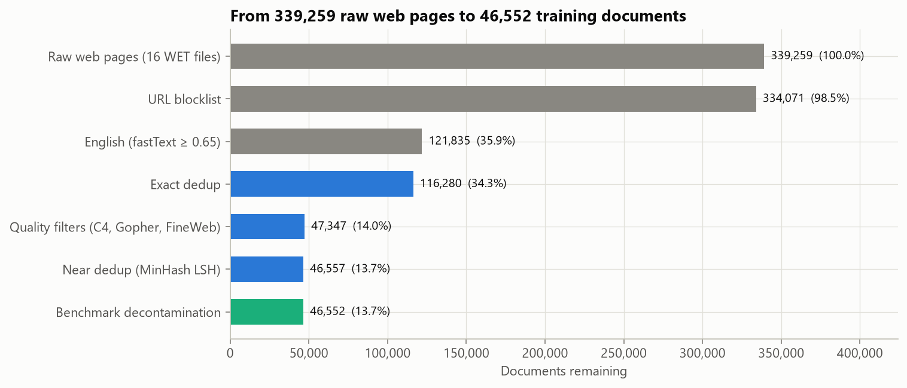
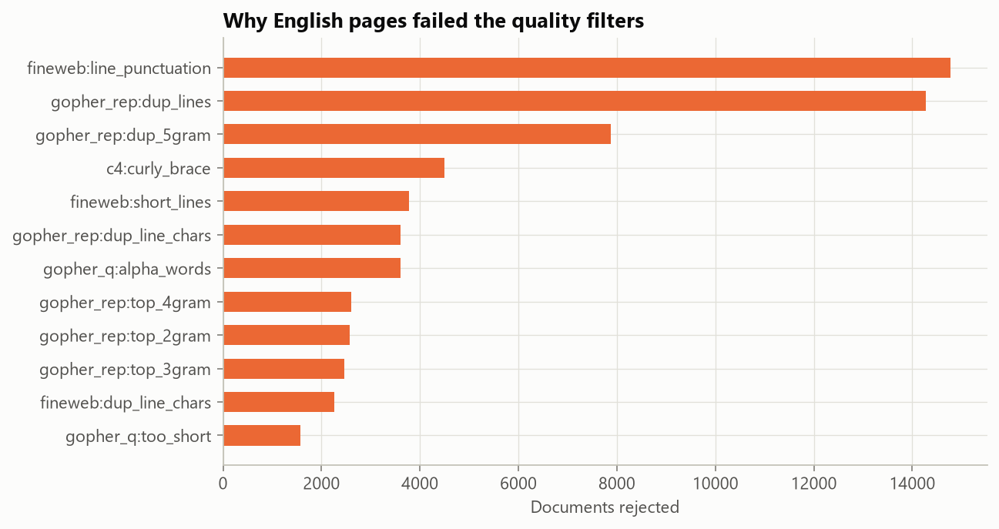
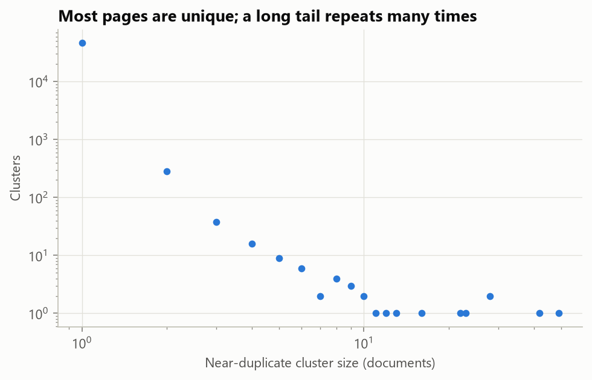
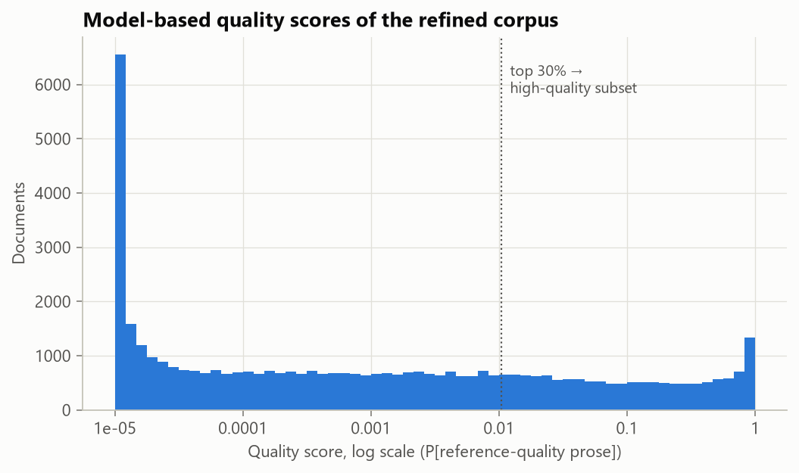

# From raw web crawl to LLM training tokens: a pretraining data refinery

   

Large language models are mostly trained on filtered web crawl. How well that text is filtered shows up directly in how good the model is. FineWeb, for example, beat other open web datasets mainly through better filtering and deduplication ([Penedo et al., 2024](https://arxiv.org/abs/2406.17557)). This project builds that pipeline end to end on real data. It takes 16 raw text files from the September 2026 Common Crawl (**339,259 web pages, 2.26 GB of text**) and produces a deduplicated, decontaminated, PII-redacted English corpus. The corpus is scored by a quality classifier and tokenised into training shards with checksums.

**Result:** **46,552 documents (13.7% of the raw pages)** and **62.1M tokens** survive, plus a 21.9M-token high-quality subset. The whole graph runs in **about 6 minutes on a laptop CPU**. Every rejected page is logged with the rule that removed it, so any number below can be traced back to a document ID.



## Results at a glance

| Step | Documents left | Removed | Main reason |
|---|---|---|---|
| Raw pages (16 WET files, CC-MAIN-2026-39) | 339,259 | | |
| URL blocklist | 334,071 | 5,188 | adult, gambling and spam domains |
| English, fastText lid.176 P ≥ 0.65 | 121,835 | 212,236 | Russian, German, Japanese, French lead |
| Exact dedup (normalised text hash) | 116,280 | 5,555 | |
| Quality filters (C4 + Gopher + FineWeb) | 47,347 | 68,933 | lines without end punctuation, repeated lines |
| Near dedup (MinHash LSH) | 46,557 | 790 | 374 clusters, largest has 49 copies |
| Benchmark decontamination (13-gram) | **46,552** | 5 | 4 MMLU, 1 HumanEval |

| Output | Value |
|---|---|
| Tokens, o200k_base (all / high-quality top 30%) | 62,057,879 / 21,877,944 |
| Training shards | 4 + 2 uint32 `.npy` files of 20M tokens, sha256 in a manifest |
| Mean document length | 1,333 tokens |
| PII pattern matches redacted | 18,656 phone, 6,913 e-mail, 489 public IP, 399 card; 11,629 documents touched |
| Quality classifier (fastText, held-out) | 97.9% accuracy, ROC AUC 0.997 |
| Common Crawl's own CLD2 tag agrees "English" on kept documents | 99.95% |

## What the funnel shows

1. **Most of the web is not English, and most English pages are not prose.** 63% of pages are removed by language ID alone. Of the English pages left after exact dedup, only 41% pass the quality rules. The biggest single reason is FineWeb's line-punctuation rule (14,781 pages): navigation menus, product grids and tag clouds where few lines end in a full stop. Next come Gopher's duplicate-line rule (14,269) and its duplicate 5-gram rule (7,884), which catch boilerplate repeated within a page.

   

2. **Near-duplicates are rare within one sample but cluster hard.** MinHash finds 790 near-copies in 374 clusters. Cluster sizes fall off like a power law. The largest clusters are machine-made pages: a spare-parts catalogue (49 copies), parked-domain sale pages (42) and a local-services site (28). FineWeb removes far more because it deduplicates across a whole crawl of about 100,000 files. A 16-file sample sees only a small part of each cluster, which the limitations section covers.

   

3. **Benchmark overlap mostly comes from the sources benchmarks quote.** Five kept documents share a 13-word sequence with a benchmark test set: four with MMLU and one with HumanEval. None is a quiz or answer site. They include an autobiography in an online library, a law journal article and a blog post. MMLU's history and law questions quote primary sources, and the same passages sit on the open web. Removing them is still correct, because a model that has memorised the passage has an easier question. The overlap is listed by benchmark in [`contamination_by_benchmark.csv`](reports/tables/contamination_by_benchmark.csv).

4. **Scoring for quality changes what "the corpus" is.** A fastText classifier learns to tell Wikipedia lead sections from random English web pages. Its scores span five orders of magnitude, and the top 30% (score ≥ 0.0105) becomes the high-quality subset of 13,966 documents and 21.9M tokens. This is the same idea as FineWeb-Edu and DCLM, at laptop scale.

   

## Pipeline

```
WET files ─► extract + URL blocklist + fastText language ID   (per file, 8 processes)
          ─► exact dedup                                       (global hash set)
          ─► C4 line cleaning ► Gopher repetition ► Gopher quality ► FineWeb filters
          ─► MinHash signatures (112 hashes, word 5-grams)    (per file)
          ─► LSH 14 bands × 8 rows ► verify J ≥ 0.70 ► union-find   (global)
          ─► 13-gram decontamination + PII redaction
          ─► fastText quality score ► Parquet corpus ► tiktoken o200k_base shards
```

Each box is a [Dagster](https://dagster.io/) asset with its counts and timings attached as metadata, so `dagster dev -m refinery.assets` shows the lineage graph. Stages write one Parquet file per input file under `data/stages/`, plus a drop log (`doc_id`, `reason`) for every rejected page. Only the two global steps, exact and near dedup, hold anything for the whole corpus in memory, and they hold only hashes and 112-number signatures. Memory stays flat as files are added.

| Stage | Seconds | Documents in | Docs per second |
|---|---|---|---|
| Extract + URL + language | 80.6 | 339,259 | 4,209 |
| Exact dedup | 58.6 | 121,835 | 2,079 |
| Quality filters | 125.1 | 116,280 | 929 |
| MinHash signatures | 33.0 | 47,347 | 1,435 |
| LSH clustering | 2.6 | 47,347 | 18,210 |
| Decontamination + PII | 34.5 | 46,557 | 1,349 |
| Tokenise + shard | 19.3 | 46,552 | 2,412 |

### Key design decisions

- **Published thresholds, not tuned ones.** Every rule and threshold in [`config.py`](src/refinery/config.py) comes from C4 ([Raffel et al., 2020](https://arxiv.org/abs/1910.10683)), Gopher ([Rae et al., 2021](https://arxiv.org/abs/2112.11446)) or FineWeb. The point is to reproduce known-good filtering faithfully and measure what it does, not to invent new rules.
- **Vectorised MinHash.** Signatures use multiply-shift hashing over xxh64 shingle hashes in NumPy, with no MinHash library: 47,347 documents in 33 seconds on 8 processes. LSH candidates are checked against an estimated Jaccard of 0.70 before merging, so a single colliding band cannot chain unrelated pages together. The earliest document in each cluster is kept, along with a `cluster_size` field.
- **Cheap decontamination at full recall.** 944,399 13-gram hashes from the MMLU, ARC-Challenge, GSM8K, TruthfulQA and HumanEval test sets sit in one Python set. Every document is checked against all of them, the GPT-3 recipe.
- **Card numbers only if they pass Luhn.** Long digit strings such as order numbers and ISBNs fail the checksum and stay. Private and documentation IP ranges are left alone, as in FineWeb.
- **Balanced classifier inputs.** Wikipedia leads are short and web pages are long, so both classes are cut to their first 300 words. Otherwise the classifier would learn document length rather than writing quality.
- **Idempotent, restartable runs.** Re-running a stage overwrites its own per-file outputs. Shards are rewritten deterministically, and their sha256 checksums match across runs (tested).
- **No crawl text in git.** The repository publishes counts, URLs and figures only. The corpus stays in `data/output/`, which is git-ignored.

Two bugs found while running at full scale are worth recording. First, Common Crawl file numbers repeat across crawl segments (`...-00000.warc.wet.gz` appears four times in the sample). Parallel workers keyed by that number overwrote each other's Parquet files, so keys now include the segment timestamp and the stage refuses to run if two keys collide. Second, fastText's default 2M-bucket n-gram table ran out of memory next to the loaded corpus. 200k buckets is plenty for 4,000 training documents.

## Outputs

```
data/output/
├── corpus/part-*.parquet      doc_id, url, domain, date, text, cluster_size, pii_redactions,
│                              quality_score, high_quality, n_words
├── tokens/all-0000N.npy       uint32 o200k_base tokens, EOT between documents
├── tokens/all-manifest.json   token counts and sha256 per shard
├── tokens/hq-*.npy            the high-quality subset
└── DATASET_CARD.md            sources, processing, fields, known limitations
```

A copy of the [dataset card](reports/DATASET_CARD.md) is in `reports/`, along with every table behind the figures and an auto-generated [RESULTS.md](reports/RESULTS.md).

## Limitations

- **A sample of one crawl.** 16 of the crawl's ~100,000 WET files. Filter pass rates carry over to the full crawl, but near-dedup rates do not: most copies of a page live in files this sample never sees.
- **PII redaction is pattern-based and unaudited for precision.** Counts are regex matches. Phone patterns will also match some IDs and dates, while names and street addresses are not detected at all. A production pipeline would add an NER model (Presidio, for example) and a hand-labelled precision check.
- **The URL blocklist is short.** FineWeb uses the full UT1 list.
- **"Quality" means "looks like Wikipedia".** The classifier favours encyclopedic prose over good conversational or technical writing. Its 0.997 AUC mostly says that random web pages and Wikipedia are easy to tell apart, not that it ranks good web pages well. Training ablations, a small model trained on each subset, are the real test and are out of scope here.
- **No model training.** The project produces the data and its statistics. It does not show downstream benchmark gains.

## Reproduce

```bash
python -m venv .venv && .venv/Scripts/activate     # or source .venv/bin/activate
pip install -r requirements.txt
python scripts/download_data.py --files 16          # ~1.1 GB: WET files, benchmarks, lid.176.ftz
python scripts/run_pipeline.py                      # ~6 min on 8 cores, then figures + tables
pytest -q                                           # 12 unit tests, no data needed
```

`dagster dev -m refinery.assets` (run from `src/`) opens the asset graph in the Dagster UI.

## Repository structure

```
├── scripts/
│   ├── download_data.py      WET sample, benchmark test sets, fastText language model
│   └── run_pipeline.py       materialise all Dagster assets, then build the report
├── src/refinery/
│   ├── assets.py             Dagster asset graph
│   ├── stages.py             per-file stage functions, drop logs, process pool
│   ├── warc.py               streaming WET (WARC) reader
│   ├── filters.py            URL, C4, Gopher and FineWeb rules
│   ├── minhash.py            vectorised MinHash, LSH, union-find
│   ├── decontam.py           13-gram benchmark index
│   ├── pii.py                e-mail, phone, IP and Luhn-checked card redaction
│   ├── classifier.py         Wikipedia-vs-web fastText quality model
│   ├── tokenize_shards.py    tiktoken shards and manifest
│   ├── report.py             figures, tables, metrics.json, dataset card
│   └── config.py             every threshold, with its source
├── tests/test_refinery.py
└── reports/                  figures, tables, RESULTS.md, DATASET_CARD.md
```

## References

- Penedo et al. (2024). *The FineWeb Datasets: Decanting the Web for the Finest Text Data at Scale.* [arXiv:2406.17557](https://arxiv.org/abs/2406.17557)
- Rae et al. (2021). *Scaling Language Models: Methods, Analysis & Insights from Training Gopher.* [arXiv:2112.11446](https://arxiv.org/abs/2112.11446)
- Raffel et al. (2020). *Exploring the Limits of Transfer Learning with a Unified Text-to-Text Transformer* (C4). [arXiv:1910.10683](https://arxiv.org/abs/1910.10683)
- Li et al. (2024). *DataComp-LM: In search of the next generation of training sets for language models.* [arXiv:2406.11794](https://arxiv.org/abs/2406.11794)
- Brown et al. (2020). *Language Models are Few-Shot Learners* (13-gram decontamination). [arXiv:2005.14165](https://arxiv.org/abs/2005.14165)
- Broder (1997). *On the resemblance and containment of documents* (MinHash).
- Common Crawl, CC-MAIN-2026-39. Use is subject to the [Common Crawl terms of use](https://commoncrawl.org/terms-of-use).
